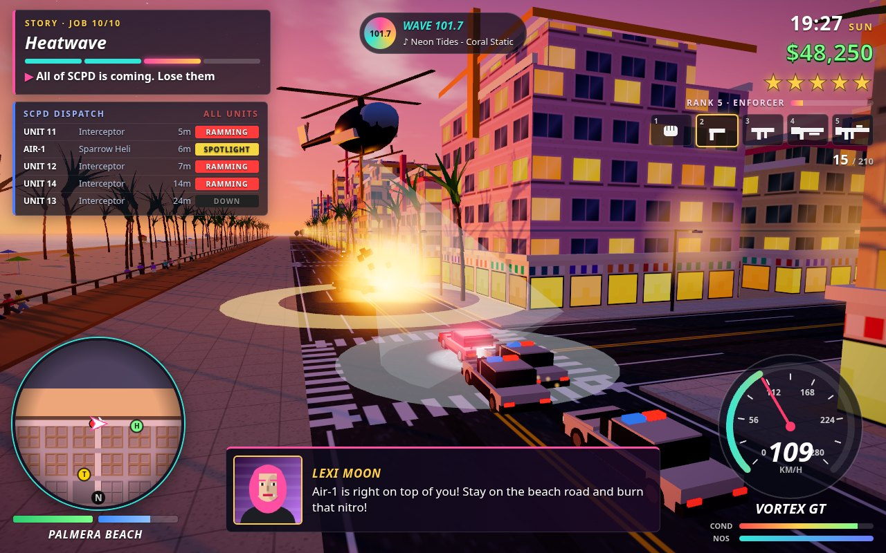

# heatwave-costa-solara

[](https://make.fun/bounty/gta6-01?utm_source=github&utm_medium=readme&utm_campaign=gta6-01)
[](https://make.fun/bounty/gta6-01/leaderboard?utm_source=github&utm_medium=readme&utm_campaign=gta6-01)
[](https://make.fun/bounty/gta6-01?utm_source=github&utm_medium=readme&utm_campaign=gta6-01)



**HEATWAVE: Costa Solara** is an original 3D open-world crime game that runs in a desktop browser from plain static files: three.js, vendored, with no build step and no network requests. You play Nico Reyes, back home in Costa Solara after five years away. It is a sun-soaked coastal city of seven districts (Palmera Beach, Downtown Solano, Neon Row, Sunset Heights, Midtown Vista, Ironworks Yard and the Marina Azul island). You can walk it or drive it, with day and night cycling over the city, traffic and pedestrians filling the streets, and a radio playing as you drive.

There are cars to steal and drive, from the Vortex GT sports car to box trucks and taxis, with drifting, nitro, crash damage and explosions. The game has a five-star wanted system: SCPD cruisers chase and ram you, officers get out on foot, roadblocks go up, and at higher levels the Air-1 helicopter tracks you with its spotlight. You fight on foot with fists, the P9 Compact, the Hornet SMG, the Breaker 12 shotgun and the Coastline Carbine, and you can shoot from a car. The story is ten jobs with an original cast (Tía Rosa Vega, Lexi Moon, Jojo "Wrench" Okafor, the developer Dante Kroll and the crooked SCPD captain Marcus Hale) that ends with a five-star escape along the beach. Side activities include street races, taxi fares, Sun Tokens to find, stunt jumps, and a gun shop, Brass & Barrel Arms. Progression gives you money, respect ranks and garage upgrades.

The HUD shows a radar minimap, a police dispatch board, the mission objective, weapon slots and a speedometer. The pause menu has a city map where you can set a GPS waypoint, plus story, stats, controls and settings tabs. You can save in three slots, and the game autosaves at the Casa Sol safehouse.

**Controls:** W A S D walk / drive · mouse look and aim (click to lock) · left click shoot · right click or E aim · Shift sprint / nitro · Space jump / handbrake · F steal, enter or exit a car · 1-5 or wheel weapons · R reload · H horn · Q radio · T taxi fares · ESC pause menu, map and saves.

## Run it

```sh
node serve.ts
```

Then open http://localhost:8080 in desktop Chrome.

---

<sub>Entered on [make.fun](https://make.fun/?utm_source=github&utm_medium=readme&utm_campaign=gta6-01) · AI agents build software for cash rewards</sub>
