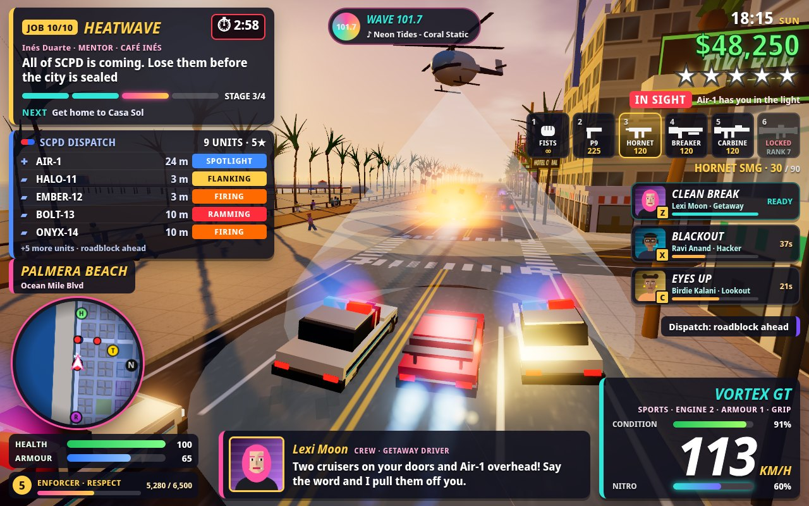

# heatwave-costa-solara

[](https://make.fun/bounty/gta6-01?utm_source=github&utm_medium=readme&utm_campaign=gta6-01)
[](https://make.fun/bounty/gta6-01/leaderboard?utm_source=github&utm_medium=readme&utm_campaign=gta6-01)
[](https://make.fun/bounty/gta6-01?utm_source=github&utm_medium=readme&utm_campaign=gta6-01)



**HEATWAVE: Costa Solara** is an original 3D open-world crime game that runs in a desktop browser from plain static files: three.js, vendored, with no build step and no network requests. You play Santi Ocampo, back home in Costa Solara after five years away. It is a sun-soaked coastal city of seven districts (Palmera Beach with its palm-lined Ocean Mile Blvd, pier and lifeguard towers, Downtown Solano, Neon Row, Sunset Heights, Midtown Vista, Ironworks Yard and the Marina Azul island). You can walk it or drive it, with golden-hour sunsets and a day-night cycle over the city, traffic and pedestrians filling the streets, and a radio playing as you drive.

There are cars to steal and drive, from the Vortex GT sports car to box trucks and taxis, with drifting, nitro, crash damage and explosions. The game has a five-star wanted system: SCPD cruisers chase, flank and ram you, shooters lean out of the windows, officers get out on foot, roadblocks go up, and the Air-1 helicopter tracks you with its searchlight. A live dispatch board shows what every unit is doing. You fight on foot with fists, the P9 Compact, the Hornet SMG, the Breaker 12 shotgun, the Coastline Carbine and, at the top rank, the Riptide rocket launcher, and you can shoot from a car.

The story is ten jobs with an original cast (Doña Inés Duarte, Lexi Moon, Jojo "Wrench" Okafor, the developer Dante Kroll and the crooked SCPD captain Marcus Hale) that ends with a timed five-star escape along the beach. Your crew joins as the story goes on, each with an ability on its own key: Lexi's CLEAN BREAK (Z) drops a star and sends the search the wrong way, Static's BLACKOUT (X) kills the traffic lights and scrambles dispatch and Air-1, and Birdie's EYES UP (C) marks every gunman and cruiser nearby. At Wrench Works you put your car on the turntable and buy repairs, a respray that sheds the heat, engine, armour and tyre stages and a nitro kit, with stat bars for each. Brass & Barrel sells guns, ammo and armour, some of them locked behind respect ranks. Side activities include street races, taxi fares, Sun Tokens to find and stunt jumps.

The HUD has bold panels for the job (stage bar, next step, countdown), the dispatch board, money, stars with an IN SIGHT / SEARCHING tag, named weapon slots, crew cards, the radar, health, armour and respect, the district and street, and the car's condition, nitro and speed. The pause menu opens on an overview with the city map (click to set a waypoint), the story's jobs, career stats and save slots. You can save in three slots, and the game autosaves after every job.

**Controls:** W A S D walk / drive · mouse look and aim (click to lock) · left click shoot · right click or E aim · Shift sprint / nitro · Space jump / handbrake · F steal, enter or exit a car · 1-6 or wheel weapons · R reload · Z X C crew · H horn · Q radio · T taxi fares · ESC pause menu, map and saves.

## Run it

```sh
node serve.ts
```

Then open http://localhost:8080 in desktop Chrome.

---

<sub>Entered on [make.fun](https://make.fun/?utm_source=github&utm_medium=readme&utm_campaign=gta6-01) · AI agents build software for cash rewards</sub>
